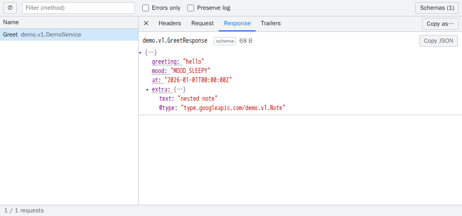

# grpc-devtools-extension

A Chrome DevTools extension that adds a **gRPC** panel for inspecting gRPC-Web and Connect requests and responses.



## Features

- Decodes gRPC-Web (binary and text) and Connect (unary, GET, and server streaming), with proto or JSON encoding
- Shows request and response messages, headers, trailers, gRPC status, and error details
- Decodes messages by field name with your schema, or by field number without one
- Browses registered schemas: services, messages, enums, `.proto` comments, type links, and where each type is used
- Explains fields on hover in decoded messages, and warns when a response has fields the schema does not define
- Copies a call as a `buf curl` or `grpcurl` command (`grpcurl` needs the server to speak native gRPC)
- Filters by method or errors only, keeps the log across navigations, copies messages as JSON

## Install

Requires Node.js and pnpm (the version is pinned in `package.json`).

```bash
pnpm install
pnpm build
```

Open `chrome://extensions`, enable **Developer mode**, click **Load unpacked**, and select `dist/`. Then open DevTools on your page and choose the **gRPC** tab. Only requests made while DevTools is open are recorded.

## Schemas

Without a schema, messages are shown by field number. To see field names, generate a FileDescriptorSet from your `.proto` files and add it under **Schemas → Manage**. `buf build` keeps `.proto` comments for the schema browser; with `protoc`, add `--include_source_info`.

```bash
buf build -o descriptor.binpb
# or
protoc -I proto --include_imports --descriptor_set_out=descriptor.binpb $(find proto -name '*.proto')
```

- **Add a file**: drop or choose the file. Use **Replace** after regenerating it.
- **Add from URL**: point to a descriptor your dev server serves. It is re-fetched each time the panel opens.

Each schema can be limited to request URLs with **Applies to** patterns, such as `http://localhost:8080/*` or `https://*.stg.example.com/*`. This lets different environments or services use different versions of the same proto. Patterns are matched against the request URL, not the page URL. Schemas whose pattern matches a request take priority over schemas without patterns. Schemas added from a URL default to that URL's origin.

## Limitations

- Streams appear when they finish. A stream that never ends is not shown.
- Compressed messages (`grpc-encoding: gzip` and similar) are not decoded yet.

## Development

Additional tools:

- Playwright's Chromium for component and E2E tests: `pnpm exec playwright install chromium`
- [mise](https://mise.jdx.dev/) for `buf` and `protoc` when regenerating the example: `mise install`
- Docker for visual regression tests

```bash
pnpm dev               # rebuild dist/ on change (reload the extension in chrome://extensions)
pnpm typecheck
pnpm test              # unit + component tests (Vitest; components run in browser mode)
pnpm test:e2e          # Playwright: real Chrome + DevTools + demo server
pnpm test:vrt          # screenshot tests rendered by Chromium in Docker (add -u to update baselines)
pnpm fixtures:record   # re-record tests/fixtures/demo-calls.json from the demo app
pnpm example:gen       # regenerate example code and descriptor sets
pnpm example:build && pnpm example:serve   # demo app at http://localhost:8080, native gRPC on localhost:8081
pnpm package           # build and zip into release/
```

### Release

The version lives in `package.json` and is written into the built manifest. To publish to GitHub Releases with `gh`:

1. Bump `version` in `package.json` (1-4 numbers, e.g. `0.2.0`), commit, and push to `main`.
2. Run `pnpm release`. It checks that `main` matches `origin/main` and the tag is new, runs typecheck and tests, then creates the `v<version>` release with the zipped build and generated notes.

`pnpm release --dry-run` does everything except creating the release. Other flags such as `--draft` are passed to `gh release create`.

### Layout

```
extension/          the extension (DevTools page, panel UI, decoder)
  src/core/         protocol detection, framing, decoding, schemas
  src/panel/        React UI
  src/i18n/         all UI wording
example/            demo proto, Connect server, and client
tests/
  unit/             decoder, schemas, capture (Node)
  component/        UI components (Vitest browser mode)
  vrt/              screenshot tests and baselines
  e2e/              Playwright against real DevTools
  fixtures/         recorded and hand-built calls shared by the tests
```
